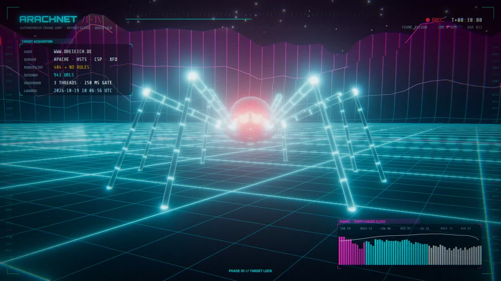
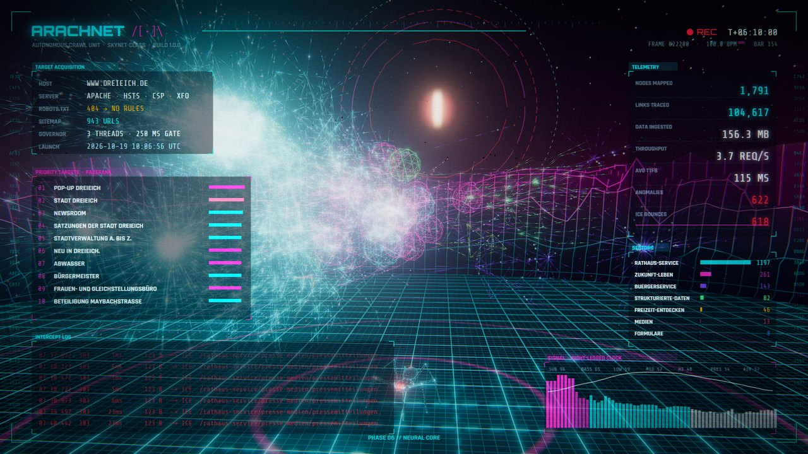

# Web crawlers /[•]\ — ArachNet edition

> **This fork turns the spider into an actual crawler.** The original is a beautiful
> DOM animation — but it never fetched a single page. ArachNet adds a polite,
> dependency-free site crawler, a real-time 3D cyberpunk visualiser that watches the
> crawl as it happens, a deterministic audio-reactive video renderer and an HTML/PDF
> audit report. The original 2D spider and Chrome extension are untouched below.



### The spider on the real website

The heart of the original — a spider walking on the words of a page — now walks a real
site, page after page, following links the crawler actually found:

- **[`browser/live.mjs`](browser/live.mjs)** opens a visible Chrome on a live site. The spider
  (the extension's spider, now with a neon look, audio coupling and a `lure()` to walk to a
  target) reads the real words — they glitch in its overlay, the page itself is never
  modified — then walks to a real content link, the view flies that link through 3D link
  space, and the next page loads. A HUD shows what the spider reads (the *read stream*), the
  page's measured TTFB / size / DOM / words, its DOM barcode, the signal and a 3D minimap.
  Polite by design: one page per `--dwell` seconds, third-party requests blocked, consent
  dialogs closed without consenting, stop on server pushback, staff-directory pages skipped.
- **[`browser/capture.mjs`](browser/capture.mjs)** walks the same kind of route once, slowly,
  and stores every same-site response in a local cache;
  **[`browser/render.mjs`](browser/render.mjs)** then renders the music video entirely
  offline: each page runs on a virtual clock (rAF, timers, `Date`), segments follow the
  song's sections, link walks are timed to land on downbeats, the site turns negative as the
  spider takes over, the firewall's own error page goes red, and the 3D visualiser provides
  the interludes.

```bash
cd browser && npm install
node live.mjs https://www.example.org --dwell 25 --pages 20                 # watch it live
node capture.mjs https://www.example.org --pages 30 --delay 20000 --crawl ../runs/<run>/crawl.json
node export-graph.mjs ../runs/<run> ../video3d/build/webcache/route.json ../video3d/build/web-graph.json
node render.mjs --still 30,120 && node render.mjs --workers 3 && node render.mjs --assemble
```

| Part | What it does |
|---|---|
| [`crawler/`](crawler) | **ArachNet engine** (Node ≥ 22, zero dependencies): robots.txt (RFC 9309) with Crawl-delay, sitemap/sitemap-index discovery, meta robots + `X-Robots-Tag` (`nofollow` pages only expand into URLs the operator published), shared politeness gate with adaptive back-off and `Retry-After`, **automatic stop when the server pushes back** (429/503 or bounces to error pages), redirect chains, TTFB/total timings, page weight and gzip potential, SEO + accessibility signals, DOM fingerprints, full link graph with click depth and PageRank. Every step is an event (`events.ndjson`), streamed live over SSE. |
| [`crawler/report.mjs`](crawler/report.mjs) | One self-contained HTML audit (inline SVG charts with hover, tables, light/dark) + PDF: findings ranked by severity, crawl timeline, status codes, TTFB and size distributions, SEO table, alt texts, security headers, broken targets, redirects, PageRank, external domains. |
| [`viz3d/`](viz3d) | three.js visualiser. **Live**: the graph grows while you crawl. **Replay**: a recorded crawl with its soundtrack. **Render**: frame-exact for video. Force-directed 3D link graph (sections become galaxies, hubs sink to the core), data packets racing along links, silk threads from the spider to every fetched page, a procedural 8-legged spider with 2-bone IK and tetrapod gait, a **data city** (one neon tower per page, height = content + PageRank; latency and anomaly scans), a spectrogram mountain ring, the Eye, and a Skynet HUD with telemetry, intercept log, radar, DOM barcodes and a reticle — all audio-reactive. |
| [`video3d/`](video3d) | `analyze_audio.py` bakes any track into per-frame spectrum/bands/onsets/beats/downbeats/sections; `render3d.mjs` captures the visualiser deterministically (virtual clock, parallel Chrome workers, NVENC) and muxes the music. Acts and camera cuts follow the song's sections and downbeats; page arrivals are quantised to 16th notes. |



### Quick start

```bash
cd viz3d && npm install && cd ..                      # three.js + fonts (local, no CDN)

# crawl with a live 3D view (open the printed URL, click to engage, C = data city)
node crawler/crawl.mjs https://www.example.org --live 8080 --audio path/to/track.wav

# audit report (+ PDF via installed Chrome)
node crawler/report.mjs runs/<host>-<stamp> --pdf

# replay a recorded crawl live, 8x speed
node crawler/crawl.mjs --replay runs/<host>-<stamp>/crawl.json --live 8080 --speed 8

# music video: analyse the track, then render (1920x1080 @ 60 fps)
cd video3d && npm install
python analyze_audio.py path/to/track.wav --title "Track Name"   # -> build/audio.{json,bin}
cp path/to/track.wav build/track.wav
node render3d.mjs --run ../runs/<host>-<stamp> --still 30,120,300   # check stills first
node render3d.mjs --run ../runs/<host>-<stamp> --workers 3          # -> out/arachnet.mp4
```

### Crawler etiquette

ArachNet is built to be a good guest: it identifies itself (`ArachNet/1.0 (+repo URL)`),
honours robots.txt and Crawl-delay, never runs more than `--concurrency` requests with at
least `--delay` ms between starts, backs off on 429/503, and **stops by itself** when a site
keeps pushing back — results so far are always written. Stop a crawl any time with Ctrl-C or
by creating a `STOP` file in its output folder. Only bypass robots.txt or `nofollow`
(`--ignore-robots-txt`, `--follow-nofollow`) on sites you are responsible for. Crawl output
(`runs/`) is git-ignored: it is your data about someone else's site.

**Deutsch, kurz:** ArachNet ist ein höflicher Website-Crawler mit Live-3D-Visualisierung,
Audit-Report (HTML/PDF) und deterministischem Musikvideo-Renderer. Er beachtet robots.txt,
drosselt sich selbst und bricht ab, wenn der Server sich wehrt.

---

## The original: a procedural spider that walks on the DOM

A procedural spider that walks on the DOM. Its feet plant on real words of the page, and every word it touches glitches into a short-lived CSS mutation — outlines, highlights, monospace blow-ups, rotated words, stretched "silk" bars, ghost echoes and long silk threads. Plain JavaScript × CSS, no build step, no dependencies.

一只在网页文字上爬行的程序化蜘蛛：它的脚踩在页面真实的单词上，被踩到的文字会短暂地“变异”——描边、高亮、等宽放大、旋转、拉伸成色条、残影、远距离蛛丝。纯 JavaScript × CSS，无需构建，无依赖。

▶ **Demo video** (40 s, original soundtrack): see the [latest release](../../releases/latest).

by **cyohei9907** · inspired by [@rybinfx](https://x.com/rybinfx)

## Run it

Open `index.html` in a browser, or serve the folder:

```bash
python -m http.server 5173
```

Then visit <http://localhost:5173>.

| Input | Effect |
|---|---|
| move the mouse | the spider chases the cursor |
| click | send the spider to that spot |
| `Space` | pause / resume |
| `F` | toggle camera follow |
| `?debug` | expose internals as `window.__crawler` (for measuring) |

## How it works

- **`js/content.js`** generates an endless "Arachnopedia" — encyclopedia-style articles with long reference lists. Every word is a `<span class="w">` so a foot can grip it. All text is procedurally generated.
- **`js/crawler.js`** is the spider:
  - 8 legs + 2 palps, two-bone IK with a fixed knee side per leg, tetrapod-ish gait with step thresholds, urgent and over-extension retraction;
  - feet are anchored to words via `elementFromPoint` and follow them each frame; if a reflow teleports a word, the foot lets go instead of being dragged;
  - mutations are CSS classes (`css/style.css`, `.m-*`) applied on plant, around the body and under the shins, then reverted;
  - **frame discipline**: `update()` and `draw()` only read the DOM, every write is queued and applied once in `commit()`, so the browser lays out once per frame;
  - the camera auto-reads downward; manual scrolling is respected for 2.5 s;
  - read articles are swapped for an equal-height spacer (constant DOM size), and the world is rebased when the spacer gets huge — it can run indefinitely at 60 fps.
- Tunables live in the `T` object at the top of `js/crawler.js` (`cruise` speed, `stopChance`, `stepFrac`, densities…).

## Chrome extension (`extension/`)

Release the spider on **any** web page: click the toolbar icon → **Release the spider** (or press `Alt+Shift+S`).

- The page is **never modified**: feet find real words with `caretRangeFromPoint` + `Intl.Segmenter` (works for CJK too), and every glitch, ghost, silk bar and thread is drawn in one overlay (closed shadow root, `pointer-events: none`, constructable stylesheet so page CSPs don't matter). Recall the spider or reload and nothing is left behind.
- Settings in the popup: auto-read (the spider scrolls the page down as it reads), size S/M/L, effects calm/normal/wild.
- Permissions: `activeTab`, `scripting`, `storage` only — no host permissions, no network, no remote code. See [PRIVACY.md](PRIVACY.md).

Try it unpacked: `chrome://extensions` → Developer mode → **Load unpacked** → select `extension/src`.

```bash
cd extension/tools
npm install         # puppeteer-core (tests use a Chromium build, e.g. Playwright's)
node e2e.mjs        # sample page, Wikipedia (en/ja), GitHub (strict CSP), chrome:// refusal, popup
node shots.mjs      # store screenshots -> ../store/screenshot-*.jpg
python make_art.py  # icons + promo tiles
python pack.py      # validate + zip -> ../dist/web-crawlers-<version>.zip
```

Store listing copy (en / zh_CN / ja), privacy answers and the submission checklist: [`extension/store/listing.md`](extension/store/listing.md).

## Demo video pipeline (`video/`)

```bash
cd video
npm install            # puppeteer-core only (uses your installed Chrome)
python music.py        # original soundtrack, numpy-synthesized -> build/music.wav
node render.mjs        # deterministic 60 fps capture + captions -> out/web-crawlers.mp4
node render.mjs --seconds 6           # quick preview
node render.mjs --mux                 # re-mux new music without re-rendering
```

`render.mjs` replaces `requestAnimationFrame` / `performance.now` / `setTimeout` with a virtual clock and seeds `Math.random`, so every frame is exact and every render is reproducible. The soundtrack (`music.py`) is an original composition in G major at 120 BPM whose sections line up with the video's bar-length scenes.

Set `CHROME=/path/to/chrome` if Chrome is not at the default Windows location.
